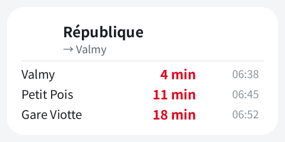

# Divia Widget

**Live bus & tram departures for Dijon, right on your home screen.**

by **Snassyyy**



A zero-dependency, zero-account Android home-screen widget showing the next
3 departures for any Divia line or stop — powered by the official French
open-data realtime feed (`transport.data.gouv.fr`). No Gradle, no analytics,
no special permissions beyond the network: the whole app is ~35 KB of
hand-written Java and one hand-rolled GTFS-RT protobuf parser.

- **Any line or any stop** — line+direction mode, or whole-stop mode merging
  every quay of a physical stop.
- **Live predictions** — times come from the GTFS-RT trip-update feed, so a
  delay is already baked into what you see.
- **Explicit lateness marker** — an amber countdown plus a compact `+4′`
  (or `+2h05`) tag when a vehicle runs ≥ 2 min behind the published
  timetable. Cancelled trips are filtered out.
- **5-minute auto-refresh + tap-to-refresh**, self-healing widgets, offline
  fallback with "last good data" rows.
- **Clean companion app** — home screen listing your widgets, and a Settings
  screen with diagnostics (bound widget ids, launcher, last refresh, last
  error), feed test and repair actions.
- **FR/EN, day/night themes.** Android 5.0+ (API 21), target 34.

## Reading the widget

Each row is: destination · countdown · clock time.

- The clock time is the **live prediction** — if the vehicle is late, that
  time already includes the delay.
- **Amber countdown + `+4′`** = running ≥ 2 min late vs the timetable
  (`+2h05` format past an hour). On-time or early vehicles show no marker.
- Footer `Mis à jour à HH:MM` = last successful live refresh; `Hors ligne`
  = showing cached rows (data-freshness signal, not a lateness one).

## Lateness, and why apps sometimes disagree

The delay figure is audited, not a guess: checking the whole live feed
against the official published timetable (1,600 delay-carrying events),
`predicted time − delay` reproduced the static GTFS **to the exact second
on 99.6% of events** (`tools/check_rt_vs_static.py`).

One caveat discovered in the wild: Divia publishes its GTFS **date by
date** — `calendar_dates.txt` gives every single day its own service
pattern. On 2026-11-07, a downtown demonstration put the network on a
one-off adapted plan (at Suquet, the L5 evening ran 20:10 / 20:58 / 21:44…
instead of the regular Saturday 19:57 / 20:12 / 20:27 / 20:47 / 21:14…).
That evening Google Maps kept displaying the *regular* Saturday timetable —
real times, but suspended for the day — and called the 20:13 bus "+16 min
(was 19:57)", while this widget diffed against the plan actually in force
and marked it `+3′`. Both agreed on the arrival time itself (20:13);
only the baseline differed. On disruption days, trust the app whose
baseline matches the operator's plan *for that date* — the realtime feed.

## Install

1. Grab `DiviaWidget-debug.apk` from the [releases](../../releases) page
   (or build it — see below) and install it (allow "install unknown apps"
   once).
2. Long-press an empty area of your home screen → Widgets → Divia Widget.
3. The widget appears with *Tap to pick your line and stop* — tap it,
   choose line → direction → stop (or switch to whole-stop mode).
4. Tap the widget any time to refresh; it also auto-refreshes every 5 min.

Recommended on Xiaomi/POCO/HyperOS: Settings → Apps → Divia Widget →
**Autostart ON**, Battery → **Unrestricted** (otherwise background refresh
is delayed).

## Build from source

Requirements: an Android SDK with **build-tools 34.0.0** and **platform
android-34**, a JDK 8+, `python3`, `zip`. No Gradle involved:

```bash
export ANDROID_HOME=/path/to/sdk   # or leave at ~/Android/Sdk
./build.sh        # -> DiviaWidget-debug.apk
./run-tests.sh    # JVM harness: layout whitelist + render pipeline
```

The build is intentionally paranoid about two widget-specific traps:

- **RemoteViews whitelist** — the launcher inflates the widget layout *in
  its own process* and rejects any view class outside the `@RemoteView`
  whitelist. A build-time guard (`check_widget_layout.py`) and a JVM test
  (`LayoutWhitelist`) both fail the build if a forbidden class sneaks in
  (that was the v1.x "Can't load widget on every launcher" bug: a plain
  `<View>` divider).
- **Stable resource ids** — after an in-place update, launchers re-apply
  RemoteViews cached from the *previous* APK with the old numeric ids
  baked in. `stable-ids.txt` pins every resource id, and the build fails
  if anything drifts.

`debug.keystore` ships with the repo so every rebuild installs over the
previous one. It is a debug key — fine for personal sideloading, never
for a store release; delete it and `build.sh` generates a fresh one (you
will then need to uninstall the older build first).

## Repository layout

```
AndroidManifest.xml     app manifest (version 2.1.1, API 21-34)
build.sh                raw build-tools build (aapt2 → ecj/javac → d8 → zipalign → apksigner)
run-tests.sh            JVM test harness runner
check_widget_layout.py  build-time RemoteViews whitelist guard
stable-ids.txt          pinned resource ids (widget-update safety)
debug.keystore          shared debug signing key
src/com/zai/divia/      app code (widget provider, refresh engine, activities)
src/com/zai/divia/core/ pure-Java core: catalog, GTFS-RT parser, API
res/                    layouts, strings (FR/EN), day/night themes, icon
assets/catalog.gz       compact digest of the static GTFS (bundled data)
test/                   JVM harness + android stubs
tools/                  catalog generator + the data-audit kit (python)
docs/                   preview image
```

The core (`core/`) is pure Java with no Android imports, so the whole
parsing/rendering pipeline runs on a desktop JVM — that is what
`run-tests.sh` exercises, including the layout whitelist and a full render
against the real catalog and live feed.

## Data & credits

- **Code:** © Snassyyy, MIT license (see `LICENSE`).
- **Data:** official open data of the Divia Mobilités network (operated by
  Keolis Dijon), redistributed via
  [transport.data.gouv.fr](https://transport.data.gouv.fr) (dataset
  `gtfs-diviamobilites`). Check the dataset page for the current data
  license terms; `assets/catalog.gz` is a derived digest of that feed and
  can be regenerated with `tools/gen_catalog.py`.
- The bundled catalog covers the network until **2027-01-03**; after that
  date, regenerate it and rebuild.
- This project is not affiliated with Divia, Keolis Dijon or
  transport.data.gouv.fr. The app contacts exactly one host:
  `proxy.transport.data.gouv.fr`.
